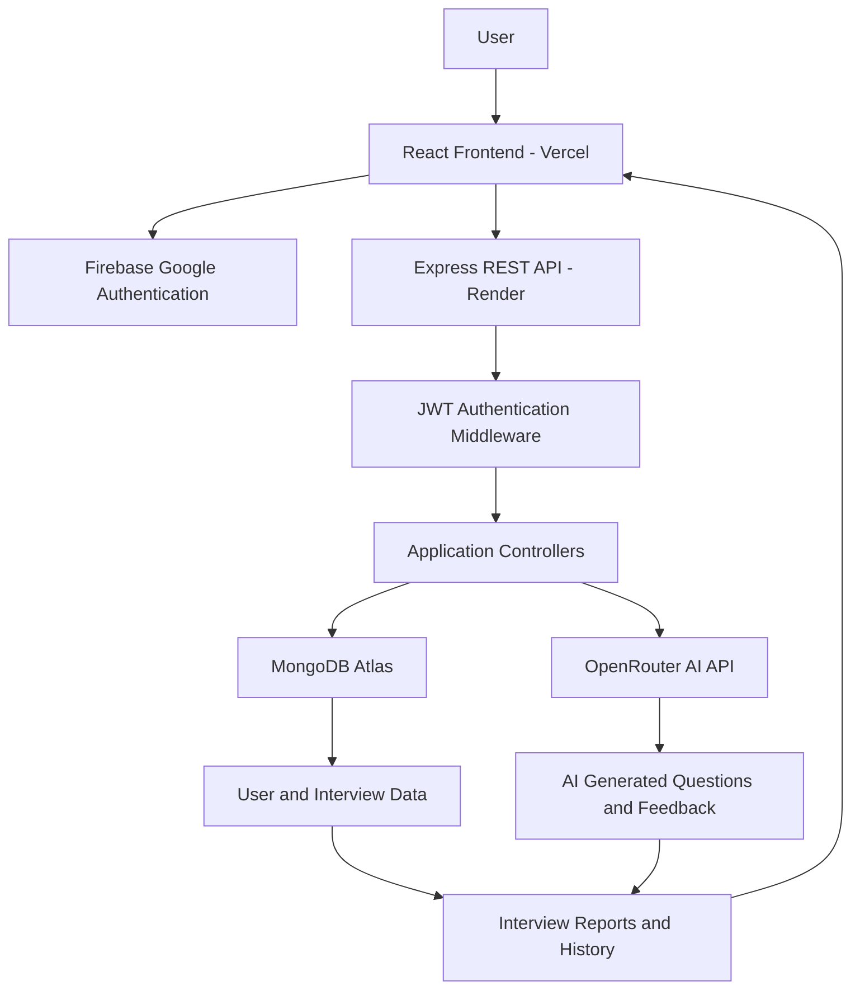

# VELTO — AI-Powered Interview Preparation Platform

<p align="center">
  <strong>MEET YOUR POTENTIAL.</strong>
</p>

<p align="center">
  An AI-powered interview preparation platform that helps candidates practice smarter, evaluate their performance, and prepare for real-world technical and HR interviews.
</p>

<p align="center">
  <a href="https://velto-gold.vercel.app/">Live Application</a> •
  <a href="https://velto-0k32.onrender.com/">Backend API</a>
</p>

---

## 🚀 Overview

**VELTO** is a full-stack AI-powered interview preparation platform designed to make interview practice more structured, accessible, and data-driven.

Candidates can authenticate using Google, analyze their resumes, generate personalized interview questions, practice under time constraints, submit answers for AI-powered evaluation, and review their interview performance.

Instead of relying entirely on generic interview questions, VELTO aims to create a more personalized preparation experience based on a candidate's resume, target role, experience level, and interview mode.

The platform combines modern web technologies, AI integration, secure authentication, and persistent data storage to deliver an end-to-end interview preparation workflow.

## 🌐 Live Demo

| Component | URL |
|---|---|
| Frontend | https://velto-gold.vercel.app/ |
| Backend | https://velto-0k32.onrender.com/ |

## ✨ Key Features

### 1. Google Authentication
- Secure Google sign-in using Firebase Authentication.
- Backend-managed JWT authentication.
- HTTP-only cookies for session management.
- Protected API endpoints.
- User-specific data and interview history.

### 2. AI-Powered Resume Analysis
- Upload resumes for analysis.
- Extract relevant candidate information.
- Use AI to evaluate resume content.
- Support a more personalized interview preparation workflow.

### 3. Personalized Interview Generation
- Generate interview questions based on the candidate's preparation details.
- Select target job role and experience level.
- Choose between HR and Technical interview modes.
- Generate questions with difficulty levels and time limits.

### 4. Interactive Interview Practice
- Practice generated questions in a structured interview environment.
- Answer questions under configurable time limits.
- Track interview progress.
- Submit answers for evaluation.

### 5. AI-Powered Answer Evaluation
Evaluate interview responses using multiple performance dimensions:

- **Correctness:** Accuracy and relevance of the answer.
- **Communication:** Clarity and effectiveness of explanation.
- **Confidence:** Confidence-related performance assessment.
- **Overall Score:** Consolidated question-level evaluation.

### 6. Interview Reports and History
- Store interview sessions in MongoDB.
- Maintain question-level answers and feedback.
- Track interview completion status.
- Calculate and store final interview scores.
- Retrieve previous interview sessions.

### 7. Credit-Based Usage System
- New users receive default credits.
- Interview generation consumes credits.
- Track available credits through the user account.
- Support credit-based access to interview functionality.

### 8. Responsive User Interface
- Modern, clean interface.
- Indigo, dark navy, and white visual theme.
- Responsive layouts for different screen sizes.
- Interactive components and animations.

---

## 🛠️ Technology Stack

| Category | Technologies |
|---|---|
| Frontend | React.js, Vite, JavaScript |
| Styling | Tailwind CSS |
| Animations | Framer Motion |
| Icons | Lucide React |
| Routing | React Router DOM |
| State Management | Redux Toolkit |
| Backend | Node.js, Express.js |
| Database | MongoDB Atlas, Mongoose |
| Authentication | Firebase Authentication, JWT |
| AI Integration | OpenRouter API |
| API Communication | Axios |
| File Uploads | Multer |
| Deployment | Vercel, Render |
| Development Tools | Git, GitHub, VS Code, Postman |

## 🏗️ System Architecture



## 🔄 Application Workflow

1. **Authentication:** The user signs in using their Google account.
2. **Account Management:** The backend creates or retrieves the user's MongoDB account and establishes a JWT session.
3. **Resume Analysis:** The user uploads a resume for AI-assisted analysis.
4. **Interview Setup:** The user selects a target role, experience level, and interview mode.
5. **Question Generation:** The backend communicates with the AI service to generate interview questions.
6. **Interview Practice:** The candidate answers questions within the interview environment.
7. **Answer Evaluation:** Submitted answers are evaluated and scored.
8. **Report Generation:** Interview results and feedback are stored.
9. **Performance Tracking:** The user can revisit previous interview sessions and monitor progress.

## 🧩 Backend API

Base URL:

```text
https://velto-0k32.onrender.com
```

| Method | Endpoint | Description |
|---|---|---|
| POST | `/api/auth/google` | Google authentication and backend session creation |
| POST | `/api/auth/logout` | Logout and clear authentication cookie |
| GET | `/api/user/current-user` | Retrieve authenticated user information |
| POST | `/api/resume/analyze` | Upload and analyze a resume |
| POST | `/api/resume/generate-questions` | Generate interview questions |
| POST | `/api/resume/submit-answers` | Submit an interview answer |
| POST | `/api/resume/finish-interview` | Complete an interview |
| GET | `/api/resume/my-interviews` | Retrieve interview history |

**Note:** Protected endpoints require a valid authentication session. The API table documents the routes implemented in the project; request payloads and response schemas can be added as the API contract is finalized.

## 🗄️ Database Design

VELTO uses MongoDB with Mongoose for persistent data storage.

### User Collection

Stores user account and credit information.

| Field | Description |
|---|---|
| `_id` | Unique user identifier |
| `name` | User's name |
| `email` | User's email address |
| `credit` | Available interview credits |

### Interview Collection

Stores interview sessions and evaluation results.

| Field | Description |
|---|---|
| `userId` | Reference to the user |
| `role` | Target job role |
| `experience` | Candidate's experience level |
| `mode` | HR or Technical |
| `resumeText` | Resume information |
| `questions` | Generated interview questions |
| `finalScore` | Final interview score |
| `status` | Interview completion status |

Each question stores its difficulty, time limit, answer, feedback, score, confidence, communication, correctness, and evaluation status.

## 📁 Project Structure

A simplified overview of the application:

```text
VELTO/
│
├── client/
│   ├── public/
│   ├── src/
│   │   ├── assets/
│   │   ├── components/
│   │   ├── pages/
│   │   ├── redux/
│   │   ├── services/
│   │   ├── App.jsx
│   │   └── main.jsx
│   ├── .env
│   └── package.json
│
├── server/
│   ├── config/
│   │   ├── connectdb.js
│   │   └── token.js
│   ├── controller/
│   │   ├── auth.controller.js
│   │   └── resume.controller.js
│   ├── middleware/
│   │   ├── isauth.js
│   │   └── multer.js
│   ├── model/
│   │   ├── user.model.js
│   │   └── interview.model.js
│   ├── routes/
│   │   ├── auth.route.js
│   │   ├── user.route.js
│   │   └── resume.route.js
│   ├── service/
│   │   └── openrouter.service.js
│   ├── index.js
│   └── package.json
│
└── README.md
```

*Adjust the directory names if your current repository uses a different client/server structure.*

## ⚙️ Local Installation and Setup

### Prerequisites

Make sure you have installed:

- Node.js (LTS recommended)
- npm
- MongoDB Atlas account or a local MongoDB instance
- Firebase project
- OpenRouter API key

### 1. Clone the Repository

```bash
git clone YOUR_GITHUB_REPOSITORY_URL
cd VELTO
```

### 2. Setup the Backend

```bash
cd server
npm install
```

Create a `.env` file inside the `server` directory:

```env
PORT=8055
NODE_ENV=development

CLIENT_URL=http://localhost:5173

MONGODB_URI=your_mongodb_connection_string
JWT_SECRET=your_secure_jwt_secret

OPENROUTER_API_KEY=your_openrouter_api_key
OPENROUTER_MODEL=openai/gpt-4o-mini
```

Start the backend:

```bash
npm run dev
```

The backend should run at:

```text
http://localhost:8055
```

### 3. Setup the Frontend

Open a new terminal:

```bash
cd client
npm install
```

Create a `.env` file inside the frontend directory:

```env
VITE_SERVER_URL=http://localhost:8055
```

Configure the Firebase client credentials using the Firebase configuration expected by your application.

Start the frontend:

```bash
npm run dev
```

The frontend should run at:

```text
http://localhost:5173
```

### 4. Firebase Configuration

1. Create a project in Firebase Console.
2. Enable Google as a sign-in provider under Authentication.
3. Register your frontend application.
4. Configure the Firebase credentials in your frontend.
5. Add your development and production frontend domains to Firebase Authorized Domains.

### 5. MongoDB Configuration

1. Create a MongoDB Atlas cluster.
2. Create a database user.
3. Configure network access.
4. Add the MongoDB connection string to your backend environment variables.

---

## 🔐 Environment Variables

Never commit `.env` files, API keys, database credentials, or JWT secrets to GitHub.

| Variable | Location | Purpose |
|---|---|---|
| `VITE_SERVER_URL` | Frontend | Backend API URL |
| `PORT` | Backend | Express server port |
| `NODE_ENV` | Backend | Runtime environment |
| `CLIENT_URL` | Backend | Allowed frontend origin |
| `MONGODB_URI` | Backend | MongoDB connection string |
| `JWT_SECRET` | Backend | JWT signing secret |
| `OPENROUTER_API_KEY` | Backend | OpenRouter authentication |
| `OPENROUTER_MODEL` | Backend | AI model selection |

Firebase client configuration must also be supplied through the frontend configuration expected by the application.

## ☁️ Deployment

VELTO is deployed using separate frontend and backend services.

**Frontend — Vercel**
- Hosts the React application.
- Uses the production backend URL through `VITE_SERVER_URL`.

**Backend — Render**
- Hosts the Express REST API.
- Connects to MongoDB Atlas.
- Handles authentication, interview operations, and AI service requests.

**Database — MongoDB Atlas**
- Stores user accounts.
- Stores interview sessions, answers, and evaluation results.

**AI — OpenRouter**
- Provides access to the configured AI model for interview-related generation and evaluation.

Production environment configuration:

```env
# Render Backend
NODE_ENV=production
CLIENT_URL=https://velto-gold.vercel.app
```

```env
# Vercel Frontend
VITE_SERVER_URL=https://velto-0k32.onrender.com
```

## 🧠 Engineering Highlights

Some of the engineering concepts demonstrated in this project include:

- Designing a full-stack application using a separate frontend and REST API backend.
- Implementing Google authentication alongside backend JWT session management.
- Protecting user-specific routes using authentication middleware.
- Designing MongoDB schemas with nested interview question documents.
- Integrating external AI services through an API abstraction layer.
- Handling resume uploads and backend processing.
- Managing application state using Redux Toolkit.
- Building a credit-based usage model.
- Persisting interview progress and evaluation results.
- Configuring cross-origin requests and cookie-based authentication across separate deployment domains.
- Deploying and maintaining frontend and backend services independently.

## 🔮 Future Improvements

- Real-time AI interviewer with voice interaction.
- Speech-to-text answer capture and voice-based feedback.
- AI-generated follow-up questions based on previous answers.
- More detailed performance analytics and progress tracking.
- Personalized preparation roadmaps based on interview weaknesses.
- Additional interview categories and role-specific question banks.
- Integrated payment gateway and automated credit purchases.
- More comprehensive automated testing and API documentation.

## 🎯 Project Objective

The objective behind VELTO is to make interview preparation more personalized, measurable, and accessible.

By combining AI-powered question generation, structured interview practice, and performance evaluation, VELTO aims to help candidates identify weaknesses, improve their communication, and approach real interviews with better preparation.

---

## 👨‍💻 Author

**Sharad Pal**

B.Tech Computer Science & Engineering

Interested in Full-Stack Development, Software Engineering, and AI-powered applications.

<p align="center">
  <strong>VELTO — MEET YOUR POTENTIAL.</strong>
</p>

<p align="center">
  Built with React, Node.js, MongoDB, and AI.
</p>